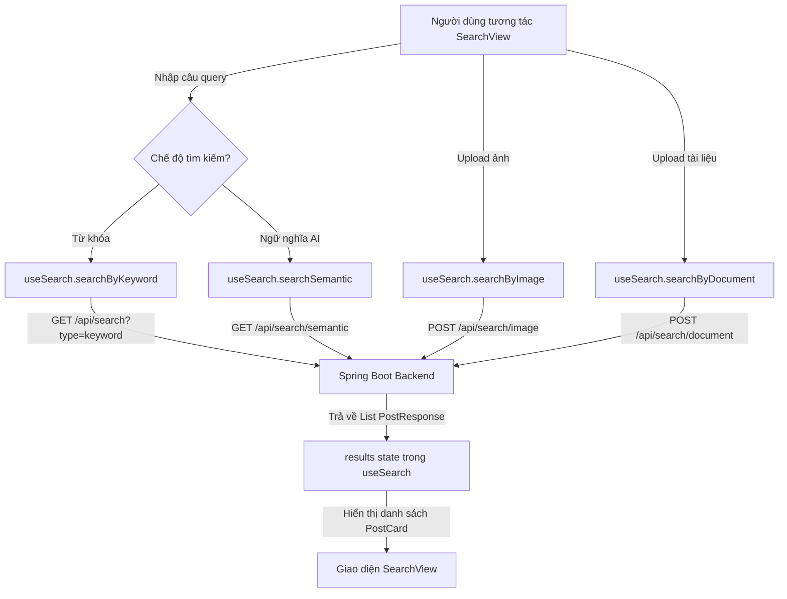

# Thiết Kế: Tìm Kiếm Đa Chế Độ Tích Hợp AI (Multi-Modal Search)

> **Mục tiêu**: Nâng cấp trang `/search` của VietBlog với thanh tìm kiếm đa năng tích hợp AI (Omni-Search Bar), cho phép người dùng tìm kiếm theo 4 phương thức: Từ khóa truyền thống, Ngữ nghĩa AI (TF-IDF + Cosine Similarity), Tìm kiếm bằng hình ảnh (Computer Vision), và Tìm kiếm bằng tài liệu (PDF/DOCX Text Extraction).

---

## 1. Bối Cảnh & Mục Đích

Trong đề cương đồ án chuyên ngành NCKH của đề tài "Xây dựng Web App quản lý bài viết tích hợp AI", chức năng tìm kiếm thông minh gồm 4 giải thuật cốt lõi:
1. **Tìm kiếm từ khóa (Keyword Search)**: Khớp chuỗi từ vựng chính xác.
2. **Tìm kiếm ngữ nghĩa (Semantic Search)**: Tự cài đặt thuật toán Vector Space Model (TF-IDF kết hợp Cosine Similarity), giải quyết vấn đề tìm kiếm theo ngữ cảnh/ý niệm thay vì chỉ khớp từ chữ cái.
3. **Tìm kiếm hình ảnh (Image Search)**: Trích xuất đặc trưng thị giác máy tính tự viết (Color Histogram HSV, Sobel Edge, GLCM Texture) $\rightarrow$ vector đặc trưng $\rightarrow$ so khớp Cosine Similarity với kho ảnh bài viết.
4. **Tìm kiếm tài liệu (Document Search)**: Đọc nội dung văn bản từ tệp PDF/DOCX tải lên $\rightarrow$ vector hóa TF-IDF $\rightarrow$ tìm bài viết tương đồng.

Hiện tại Backend Spring Boot đã có sẵn các endpoint API đầy đủ tại `SearchController`:
- `GET /api/search?q={query}&type=keyword&limit={limit}`
- `GET /api/search/semantic?q={query}&limit={limit}`
- `POST /api/search/image` (Multipart `image`)
- `POST /api/search/document` (Multipart `file`)

Đồng thời composable `frontend/src/composables/core/useSearch.ts` đã hoàn thiện các hàm gọi API. Nhiệm vụ hiện tại là nâng cấp giao diện `SearchView.vue` và component `SearchHeader.vue` để kết nối thực tế.

---

## 2. Giao Diện & Tương Tác (UI / UX)

### 2.1. Thanh Tìm Kiếm Đa Năng (Omni-Search Bar)
Nâng cấp `SearchHeader.vue` thành thanh tìm kiếm thông minh:
* **Hộp nhập văn bản chính**:
  * Icon kính lúp tìm kiếm ở đầu.
  * Input text nhập truy vấn người dùng.
  * Nút xóa nhanh `X` khi có nội dung.
  * Phím tắt `Enter` để thực hiện tìm kiếm.
* **Bộ chuyển đổi chế độ văn bản (Text Mode Toggle)**:
  * Pill button dạng toggle:
    * 🔤 **Từ khóa**: Tìm kiếm từ vựng chính xác.
    * 🧠 **AI Ngữ nghĩa**: Tìm theo ngữ cảnh ý nghĩa (TF-IDF + Cosine).
  * Hiển thị trạng thái active với gradient/màu nổi bật.
* **Nút đính kèm tệp đa phương tiện**:
  * 📷 **Tìm bằng ảnh**: Nút icon camera với tooltip "Tìm bằng hình ảnh (AI trích xuất đặc trưng)". Khi bấm mở file picker (chỉ nhận `.jpg, .jpeg, .png, .webp`).
  * 📄 **Tìm bằng tài liệu**: Nút icon tệp tin với tooltip "Tìm bằng tài liệu (PDF, DOCX)". Khi bấm mở file picker (chỉ nhận `.pdf, .docx, .txt`).
* **Hộp xem trước tệp đã chọn (File Attachment Preview)**:
  * Khi người dùng chọn ảnh: Hiển thị thumbnail ảnh, tên ảnh, dung lượng và nút xóa để hủy tìm ảnh.
  * Khi người dùng chọn tài liệu: Hiển thị icon văn bản, tên tài liệu, dung lượng và nút xóa.

### 2.2. Hiển Thị Kết Quả Tìm Kiếm
* **Thanh thông báo trạng thái & huy hiệu thuật toán**:
  * Hiển thị số lượng bài viết tìm thấy.
  * Badge ghi rõ thuật toán:
    * Chế độ từ khóa: `Thuật toán: Khớp từ vựng chính xác`
    * Chế độ ngữ nghĩa: `Thuật toán: TF-IDF + Cosine Similarity`
    * Chế độ ảnh: `Thuật toán: Computer Vision (Color Histogram + Sobel + GLCM)`
    * Chế độ tài liệu: `Thuật toán: Trích xuất văn bản + Semantic TF-IDF`
* **Danh sách kết quả**:
  * Render các bài viết bằng `PostCard.vue`.
  * Loading Skeleton: Hiển thị 3 card skeleton khi `isSearching` là `true`.
  * Empty State: Hiển thị icon thân thiện, thông báo không tìm thấy kết quả và nút gợi ý chuyển sang "AI Ngữ nghĩa" nếu đang ở chế độ từ khóa.

---

## 3. Kiến Trúc & Luồng Dữ Liệu (Data Flow)

---

## 4. Kế Hoạch Xác Minh (Verification)
1. Chạy `npm run build` trên thư mục `frontend/` đảm bảo không phát sinh lỗi TypeScript hoặc cú pháp.
2. Mở trình duyệt đến trang `http://localhost:5173/search`:
   - Gõ "hệ thống" ở chế độ **Từ khóa** $\rightarrow$ kiểm tra kết quả bài viết trả về.
   - Chuyển sang **AI Ngữ nghĩa** và gõ câu hỏi ngữ cảnh: "công nghệ đám mây và trí tuệ nhân tạo" $\rightarrow$ kiểm tra thuật toán TF-IDF trả về bài viết phù hợp.
   - Chọn tải lên một ảnh mẫu $\rightarrow$ kiểm tra thanh preview ảnh và kết quả tìm kiếm bằng ảnh.
   - Chọn tải lên một tài liệu `.docx` hoặc `.pdf` $\rightarrow$ kiểm tra kết quả tìm kiếm tài liệu.
